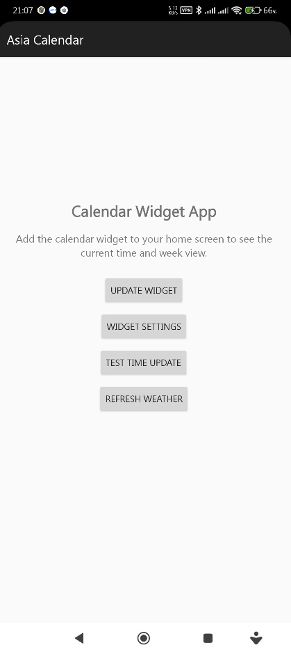
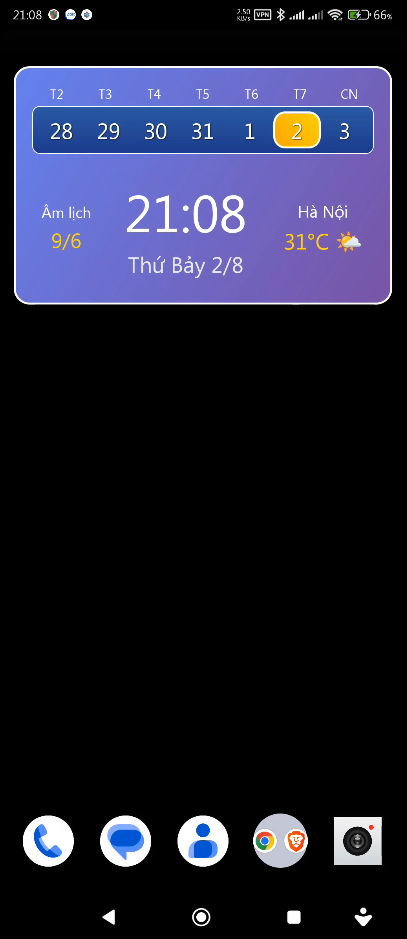

# Lịch Vạn Niên

Ứng dụng Android kết hợp xem lịch âm dương Việt Nam và các tiện ích phục vụ phong tục truyền thống, đời sống tâm linh và quản lý gia đình.

---

## 🌟 Tính năng nổi bật

### 1. Lịch Âm - Dương & Thời tiết
- **Xem ngày, tuần, tháng:** Tra cứu lịch âm - dương song hành, hiển thị đầy đủ thông tin Can Chi (ngày, tháng, năm), tiết khí, giờ hoàng đạo/hắc đạo.
- **Thời tiết hiện tại:** Tích hợp dữ liệu thời tiết (nhiệt độ, trạng thái thời tiết) từ [Open-Meteo](https://open-meteo.com/) dựa trên vị trí thành phố người dùng chọn (mặc định: Hà Nội; không tự động lấy GPS nền để đảm bảo quyền riêng tư và tiết kiệm pin).

### 2. Widget màn hình chính (Home Screen Widget)
- Tiện ích widget hiển thị trực quan ngoài màn hình chính: ngày giờ thực, lịch âm dương, thứ trong tuần và tình hình thời tiết.
- Cho phép tùy chỉnh cấu hình widget (thành phố hiển thị, giao diện).

### 3. Tra cứu & Tự động điền Văn khấn
- **Kho bài cúng phong phú:** Lưu trữ sẵn các bài văn khấn truyền thống cho mọi dịp lễ: Mùng 1, ngày Rằm, Tết Nguyên Đán, cúng giỗ, động thổ, cất nóc, khai trương, phóng sinh,...
- **Điền thông tin cá nhân tự động:** Hỗ trợ lưu hồ sơ gia chủ (tín chủ, địa chỉ cư trú, thành viên gia đình) và tự động ráp vào bài khấn phù hợp.
- **Tích hợp giọng đọc (TTS):** Chuyển đổi văn bản thành giọng nói (Text-To-Speech) trực tiếp trên thiết bị để phát âm đọc bài văn khấn.

### 4. Quản lý Gia phả & Nhắc ngày giỗ
- **Cây gia phả (Family Tree):** Thiết lập và hiển thị trực quan sơ đồ phả hệ gia đình, dòng họ qua giao diện đồ họa.
- **Suy luận danh xưng họ hàng:** Tự động tính toán vai vế, xác định cách xưng hô chính xác theo thuần phong mỹ tục Việt Nam dựa trên đồ thị quan hệ họ hàng.
- **Lưu trữ & Nhắc lịch giỗ:** Quản lý danh sách ngày giỗ theo âm lịch, hẹn giờ gửi thông báo nhắc nhở chuẩn bị cúng giỗ mỗi sáng.

---

## 📱 Ảnh chụp màn hình





---

## ⚙️ Yêu cầu môi trường

- **Hệ điều hành:** Android 7.0 trở lên (Min SDK 24, Compile / Target SDK 36).
- **Java:** JDK 17.
- **Android SDK:** Bao gồm Build-Tools và Platform SDK 36.
- **Mạng:** Kết nối Internet để lấy dữ liệu thời tiết từ Open-Meteo. Các tính năng cốt lõi (tính lịch âm, văn khấn, gia phả) hoạt động hoàn toàn offline.

---

## 🚀 Hướng dẫn Build & Cài đặt

### Build APK bằng Gradle Wrapper

- **Bản Debug:**
  ```powershell
  .\gradlew.bat assembleDebug
  ```

- **Bản Release:**
  ```powershell
  .\gradlew.bat assembleRelease
  ```

File APK đầu ra nằm tại: `app/build/outputs/apk/`.

### Tiện ích script tự động (`build.ps1`)

Dự án cung cấp script PowerShell hỗ trợ build, tự động đẩy (install) qua ADB lên thiết bị/máy ảo và mở ứng dụng:

```powershell
# Build debug và cài đặt lên máy đang kết nối
.\build.ps1

# Build release và cài đặt
.\build.ps1 prod
```

---

## 📂 Cấu trúc mã nguồn

```
calendar/
├── app/
│   ├── src/main/
│   │   ├── assets/vankhan/          # Kho dữ liệu văn khấn định dạng text
│   │   ├── java/com/calendar/tbt/   # Mã nguồn Java
│   │   │   ├── LunarCalendar.java   # Thuật toán chuyển đổi & tính toán lịch âm
│   │   │   ├── WeatherService.java  # Gọi API thời tiết Open-Meteo
│   │   │   ├── CalendarWidget.java  # Xử lý App Widget màn hình chính
│   │   │   ├── GiaPhaActivity.java  # Màn hình quản lý phả hệ
│   │   │   ├── FamilyTreeView.java  # Tùy biến view hiển thị cây gia phả
│   │   │   ├── KinshipTerms.java    # Logic tính toán danh xưng họ hàng
│   │   │   ├── VanKhanActivity.java # Màn hình danh mục văn khấn
│   │   │   ├── PrayerFiller.java    # Ráp thông tin tín chủ vào văn khấn
│   │   │   ├── SpeechReader.java    # Tích hợp Android Text-To-Speech (TTS)
│   │   │   └── PrayerReminder.java  # Thông báo nhắc nhở ngày giỗ/văn khấn
│   │   └── res/                     # Layout XML, drawable, widget config, string
│   └── build.gradle                 # Cấu hình build của module app
├── build.ps1                        # Script tự động hoá build & deploy qua ADB
└── README.md                        # Tài liệu dự án
```

---

## 📄 Giấy phép

Dự án được phân phối theo giấy phép MIT License. Xem thêm tại [LICENSE](LICENSE).
